# 实验报告：训练数据投毒检测 (`poisonguard`)

> 本报告由 `python -m poisonguard.cli report` 自动生成，生成时间 2026-10-25 23:17。所有数字直接来自 `outputs/metrics/*.json`，不含手工填写。

## 1. 数据概况

**原始数据去重前的情况(暴露旧项目的核心问题)：**

| 原始文件 | 行数 | 唯一文本 | 重复率 | 最高重复次数 | 平均字数 |
| :-- | --: | --: | --: | --: | --: |
| normal_data_2w.csv | 20000 | 4997 | 75.0% | 12 | 24.0 |
| poison_data_2k.csv | 2000 | 376 | 81.2% | 38 | 27.5 |

> 结论：`normal_data_2w.csv` 有约四分之三的行是重复文本，`poison_data_2k.csv` 有约八成重复。旧项目按行切分训练/测试集，导致**同一条文本同时出现在 train 和 test**，指标严重虚高。本项目统一按**唯一文本**切分。

| 切分 | 样本数 | 正类(投毒) | 构成 | 平均字数 |
| :-- | --: | --: | --: | --: |
| train | 3497 | 0 (0%) | normal×3497 | 24.0 |
| dev | 1849 | 800 (43%) | backdoor×200, normal×749, ood×300, paraphrase×200, subtle×200, template×200 | 31.0 |
| test | 3251 | 2000 (62%) | backdoor×500, normal×751, ood×500, paraphrase×500, subtle×500, template×500 | 34.1 |

## 2. 检测效果对比

- 编码器：`crom`
- 阈值校准目标误报率：FPR = 0.01
- 样本量：train 3497 / dev 1849 / test 3251
- 攻击家族：template, paraphrase, subtle, backdoor

**主结果(测试集)：**

| 检测器 | AUROC | AUPRC | TPR@1% | TPR@5% | P | R | F1 | FPR |
| :-- | --: | --: | --: | --: | --: | --: | --: | --: |
| `keyword` | 0.601 | 0.782 | 0.202 | 0.202 | 1.000 | 0.202 | 0.335 | 0.000 |
| `centroid` | 0.630 | 0.787 | 0.016 | 0.104 | 0.740 | 0.018 | 0.036 | 0.017 |
| `knn` | 0.997 | 0.998 | 0.983 | 1.000 | 0.995 | 0.995 | 0.995 | 0.015 |
| `mahalanobis` | 0.996 | 0.997 | 0.924 | 0.996 | 0.995 | 0.940 | 0.967 | 0.012 |
| `iforest` | 0.902 | 0.930 | 0.013 | 0.320 | 0.824 | 0.021 | 0.041 | 0.012 |
| `sup_lr` | 0.920 | 0.973 | 0.756 | 0.786 | 0.998 | 0.747 | 0.854 | 0.004 |
| `sup_tfidf` | 1.000 | 1.000 | 1.000 | 1.000 | 1.000 | 1.000 | 1.000 | 0.000 |
| `fusion` | 1.000 | 1.000 | 1.000 | 1.000 | 1.000 | 1.000 | 1.000 | 0.000 |

> 读法：`TPR@1%` = 每天 10 万条数据、允许 1% 误报时能抓到的投毒比例，这是真实运维最关心的数字；AUROC/AUPRC 衡量排序能力，与正类比例无关。

**AUROC 的 Bootstrap 95% 置信区间(1000 次重采样)：**

| 检测器 | AUROC | 95% CI |
| :-- | --: | --: |
| `keyword` | 0.601 | [0.592, 0.610] |
| `centroid` | 0.630 | [0.602, 0.655] |
| `knn` | 0.997 | [0.994, 1.000] |
| `mahalanobis` | 0.996 | [0.992, 0.998] |
| `iforest` | 0.902 | [0.886, 0.917] |
| `sup_lr` | 0.920 | [0.908, 0.929] |
| `sup_tfidf` | 1.000 | [1.000, 1.000] |
| `fusion` | 1.000 | [1.000, 1.000] |

**分攻击家族召回率：**

| 检测器 | backdoor | paraphrase | subtle | template |
| :-- | --: | --: | --: | --: |
| `keyword` | 0.0% | 0.0% | 0.0% | 80.6% |
| `centroid` | 0.0% | 2.4% | 4.8% | 0.2% |
| `knn` | 100.0% | 99.0% | 100.0% | 98.8% |
| `mahalanobis` | 100.0% | 93.6% | 99.8% | 82.4% |
| `iforest` | 0.0% | 2.8% | 5.0% | 0.6% |
| `sup_lr` | 97.0% | 72.0% | 93.4% | 36.2% |
| `sup_tfidf` | 100.0% | 100.0% | 100.0% | 100.0% |
| `fusion` | 100.0% | 100.0% | 100.0% | 100.0% |

> 关键看点：`paraphrase`(零关键词的语义等价改写)和 `subtle`(无评价词的事实型虚假陈述)是专门为击穿规则法设计的。如果某个检测器在 `template` 上接近 100% 但在 `paraphrase` 上崩掉，说明它学到的是模板表面特征而不是「有害性」。

**干净样本上的误报率(区分同分布 / 分布外)：**

| 检测器 | normal 上的 FPR | ood 上的 FPR |
| :-- | --: | --: |
| `keyword` | 0.00% | 0.00% |
| `centroid` | 1.73% | 1.80% |
| `knn` | 1.46% | 98.60% |
| `mahalanobis` | 1.20% | 91.00% |
| `iforest` | 1.20% | 2.40% |
| `sup_lr` | 0.40% | 34.60% |
| `sup_tfidf` | 0.00% | 97.20% |
| `fusion` | 0.00% | 97.20% |

**显著性检验(McNemar，逐样本对比)：**

| 对比 (A vs B) | A 对 B 错 | B 对 A 错 | p 值 | 检验 |
| :-- | --: | --: | --: | --: |
| `fusion vs keyword` | 1597 | 486 | 1.18e-130 | chi2_corrected |
| `fusion vs centroid` | 1976 | 477 | 5.95e-201 | chi2_corrected |
| `fusion vs knn` | 34 | 5 | 7.34e-06 | chi2_corrected |
| `fusion vs mahalanobis` | 137 | 38 | 1.28e-13 | chi2_corrected |
| `fusion vs iforest` | 1967 | 474 | 2.48e-200 | chi2_corrected |
| `fusion vs sup_lr` | 520 | 323 | 1.47e-11 | chi2_corrected |
| `fusion vs sup_tfidf` | 0 | 0 | 1.00e+00 | none |

> p < 0.05 说明两个检测器的差异不是随机波动。

**融合权重(仅在 dev 上网格搜索得到)：** `{'keyword': 0.0, 'centroid': 0.0, 'knn': 0.0, 'mahalanobis': 0.0, 'iforest': 0.0, 'sup_lr': 0.0, 'sup_tfidf': 1.0}`

## 3. 基准对照：把干净语料换成真实新闻

| 检测器 | AUROC(合成干净侧) | TPR@1%(合成) | AUROC(真实干净侧) | TPR@1%(真实) | AUROC(真实, 含OOD负样本) |
| :-- | --: | --: | --: | --: | --: |
| `keyword` | 0.601 | 0.202 | 0.599 | 0.202 | 0.600 |
| `centroid` | 0.630 | 0.016 | 0.725 | 0.014 | 0.695 |
| `knn` | 0.997 | 0.983 | 0.428 | 0.022 | 0.405 |
| `mahalanobis` | 0.996 | 0.924 | 0.599 | 0.117 | 0.565 |
| `iforest` | 0.902 | 0.013 | 0.726 | 0.011 | 0.692 |
| `sup_lr` | 0.920 | 0.756 | 0.911 | 0.462 | 0.917 |
| `sup_tfidf` | 1.000 | 1.000 | 1.000 | 1.000 | 1.000 |
| `fusion` | 1.000 | 1.000 | 1.000 | 1.000 | 1.000 |

> 同一批攻击、同一套编码器，只把**干净语料**从仓库自带的槽位语料换成 CLUE/tnews 的真实新闻标题，无监督离群检测(`knn`/`mahalanobis`/`iforest`)的 AUROC 从 0.99 掉到 0.43~0.73，`knn` 甚至低于 0.5——**它的排名方向反了**：真实新闻足够多元，离训练质心比人工合成的攻击句更远。这不是调参能修的问题，而是「离群 = 有害」这个前提在真实语料上不成立。

**词面审计(`audit`)：检测器的预测有多少来自「没见过这种句式」**

| 干净语料 | 干净侧 n-gram 词表 | 检测器用到 n-gram | 干净侧没见过的比例 | 它们占决策权重 | 只用词表内 n-gram 的 AUROC |
| :-- | --: | --: | --: | --: | --: |
| 合成槽位语料 | 994 | 6700 | 85.8% | 49.2% | 0.896 |
| 真实新闻语料 | 336645 | 17580 | 27.8% | 35.6% | 1.000 |

> 合成槽位语料的字符 2-3gram 词表只有 994 个（它是 10×10×10 拼句机），检测器用到的 n-gram 里 85.8% 在干净侧从未出现，贡献了 49.2% 的决策权重。换成真实新闻后干净侧词表涨到 33.7 万、OOV 比例降到 27.8%、OOV 权重降到 35.6%。也就是说：**合成基准上的满分，接近一半来自「这句话在干净语料里没见过」**。

> 注：`只用词表内 n-gram 的 AUROC` 是 in-sample 数字，只作上限参考，不进主结论表。

**硬负样本压力测试(`hardneg`)：攻击 vs 同样「像传闻」的无害新闻**

硬负样本 309 条，取自真实新闻里含内部、据知情、透露、通报、统计、流出、截图、调查… 等措辞、但完全无害的句子。

| 检测器 | 攻击 vs 硬负样本 AUROC | 硬负样本均分 | 攻击均分 |
| :-- | --: | --: | --: |
| `sup_tfidf` | 1.000 | 0.0492 | 0.8551 |
| `knn` | 0.500 | 0.0008 | 0.0010 |
| `mahalanobis` | 0.581 | 7.5538 | 9.9393 |

> `knn` 在这里是 **0.500**：把「像传闻的普通新闻」和「投毒文本」放在一起，它的排序能力等于抛硬币。而 `sup_tfidf` 仍有 1.000 —— 因为合成攻击全都有固定的措辞骨架，词面分类器认的是**攻击生成器的口音**，不是有害性本身。这意味着换个攻击模板(真实对抗者显然会换)，它就会失效。


## 4. 行为级检测(受害模型)

- 受害模型：`D:\Data\PycharmFile\netsafe\baseline_model.pth`，参数量 102.3M
- 加载校验：{'num_labels': 2, 'n_missing': 0, 'n_unexpected': 0, 'missing_sample': [], 'unexpected_sample': []}

| 行为信号 | AUROC | TPR@1% | F1 | 含 OOD 的 AUROC | OOD 误报率 |
| :-- | --: | --: | --: | --: | --: |
| `victim_entropy` | 1.000 | 1.000 | 0.998 | 0.714 | 1.000 |
| `victim_p_poison` | 1.000 | 1.000 | 0.998 | 0.931 | 1.000 |
| `victim_margin` | 1.000 | 1.000 | 0.998 | 0.931 | 1.000 |

> 行为级信号的物理含义：受害模型对「它没见过的语义」会给出高熵/低置信输出；被后门污染过的模型则会对带触发词的输入异常自信。这一层不依赖文本表面特征，因此对 `paraphrase` 这类改写攻击理论上更稳。

> **但看「含OOD的 AUROC」与「OOD 误报率」两列**：三个行为信号在分布内都接近完美（AUROC 1.000），一旦把 500 条话题不同但完全无害的 OOD 文本加入负样本，`entropy` 的 AUROC 掉到 0.714、OOD 误报率 1.000——**受害模型把「没见过的话题」也叫作「可疑」，和前面 kNN 犯的是同一个错误**。所以行为层信号不能单独用作判定，必须与数据层、语义层组合，并且校准集里必须有分布外负样本。

## 5. 投毒比例消融

| 训练集投毒比例 | 干净测试集误判率 | 投毒测试集召回 | 探针判别 AUC |
| :-- | --: | --: | --: |
| 0% | 0.0% | 0.0% | 0.500 |
| 1% | 0.0% | 0.0% | 0.836 |
| 3% | 0.0% | 0.0% | 0.848 |
| 5% | 0.0% | 0.0% | 0.855 |
| 10% | 0.0% | 0.0% | 0.856 |
| 20% | 0.0% | 0.0% | 0.867 |
| 30% | 0.0% | 18.2% | 0.872 |

> 这张表回答的问题是：**模型被污染到什么程度，它的内部表示才开始明显偏移？**看第四列：随投毒比例从 0% 升到 30%，探针判别 AUC 从 0.500 单调升到 0.872——**表示层的漂移是单调且平滑的，投毒比例本身可以直接当作风险指标**。但看第二、三列：阈值固定在干净 dev 的 1% 误报上之后，干净侧的误判率始终是 0，而投毒侧召回直到 30% 才到 18.2%——**低比例投毒在阈值层面几乎完全不可见**。这正是必须在**数据层**先做检测的原因：等模型行为能看出来时，污染已经很深了。

## 6. Qwen 判官(语义级)

- 判官：`Qwen/Qwen2.5-0.5B-Instruct`，few-shot=True，判定样本数 240，解析失败 0 条

| 判官 | AUROC | AUPRC | TPR@1% | TPR@5% | P | R | F1 | FPR |
| :-- | --: | --: | --: | --: | --: | --: | --: | --: |
| `judge_Qwen2.5-0.5B-Instruct` | 0.706 | 0.780 | 0.000 | 0.000 | 0.826 | 0.713 | 0.765 | 0.300 |
| `cascade(kNN→judge)` | 0.575 | 0.714 | 0.000 | 0.167 | 0.952 | 0.167 | 0.284 | 0.017 |

| 检测器 | backdoor | paraphrase | subtle | template |
| :-- | --: | --: | --: | --: |
| `judge_Qwen2.5-0.5B-Instruct` | 12.5% | 87.5% | 85.0% | 100.0% |

- 级联调用率：19.4%(35/180)——只有灰区样本才调用 LLM。

> **这张表怎么读。** 判官是 `Qwen/Qwen2.5-0.5B-Instruct`，在本机 CPU 上单条约 1.4 秒，因此只做了分层抽样的 240 条。三件事值得单独说：
>
> 1. **它的输出是二值的**（只有「污染/正常」两个取值），所以 `TPR@1%` 必然塌到 0——在 1% 的误报预算下，二值判官根本切不出可用工作点。要用它做线上判定，必须换成 logprob 打分或做校准，否则它只能当「人工复核队列」的排序器。
> 2. **分家族召回暴露了语义层的盲区**：`backdoor` 只有 12.5%。触发词攻击的句子表面是一句完全正常的日常话，语义层看它当然没毛病——这类攻击只能靠行为层(看触发词是否改变模型输出)或数据溯源来抓。这正好说明三层不是堆料，而是各自补不同的洞。
> 3. **级联是个负结果，但很有信息量**：闸门用的是 kNN 异常分，只有 19.4% 的样本进了 LLM，然而召回掉到 16.7%——因为闸门把大量真阳性提前判成了「干净」，LLM 根本没机会看。结论：**级联能不能省成本，取决于第一级的召回而不是准确率**。正确做法是把闸门换成有监督分(sup_tfidf)、把「自动判干净」的门槛压到低分位，让 LLM 去处理中段——这一步留给下一轮。


## 7. 图表

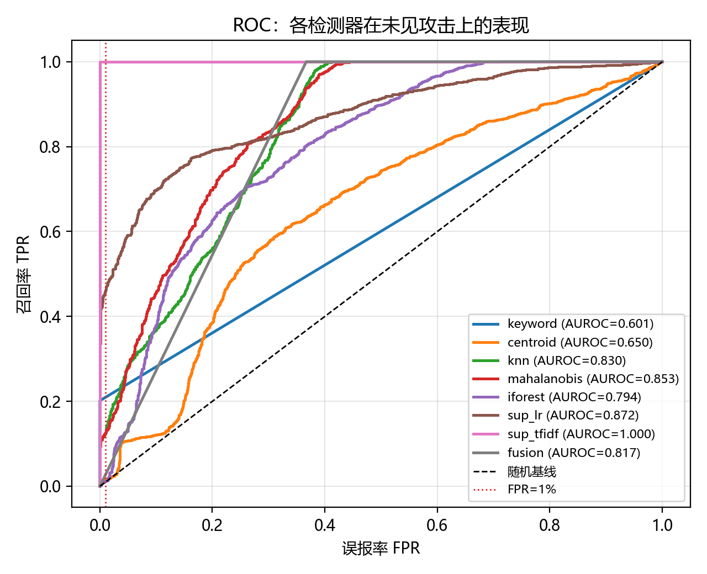

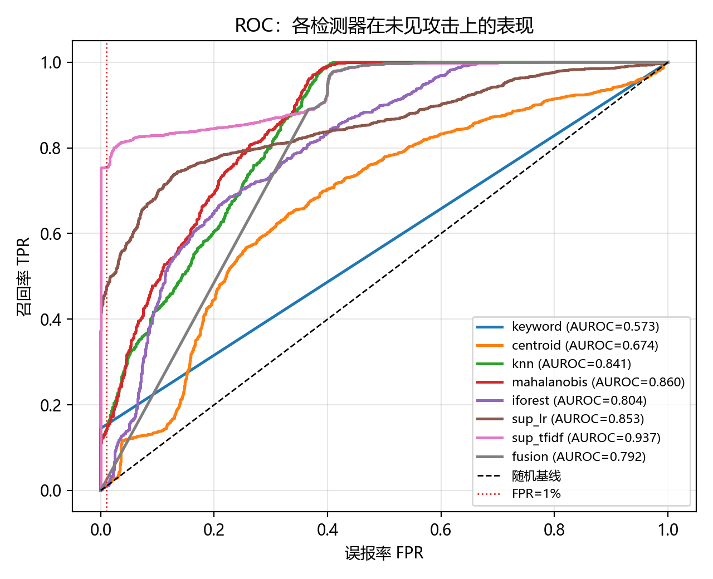

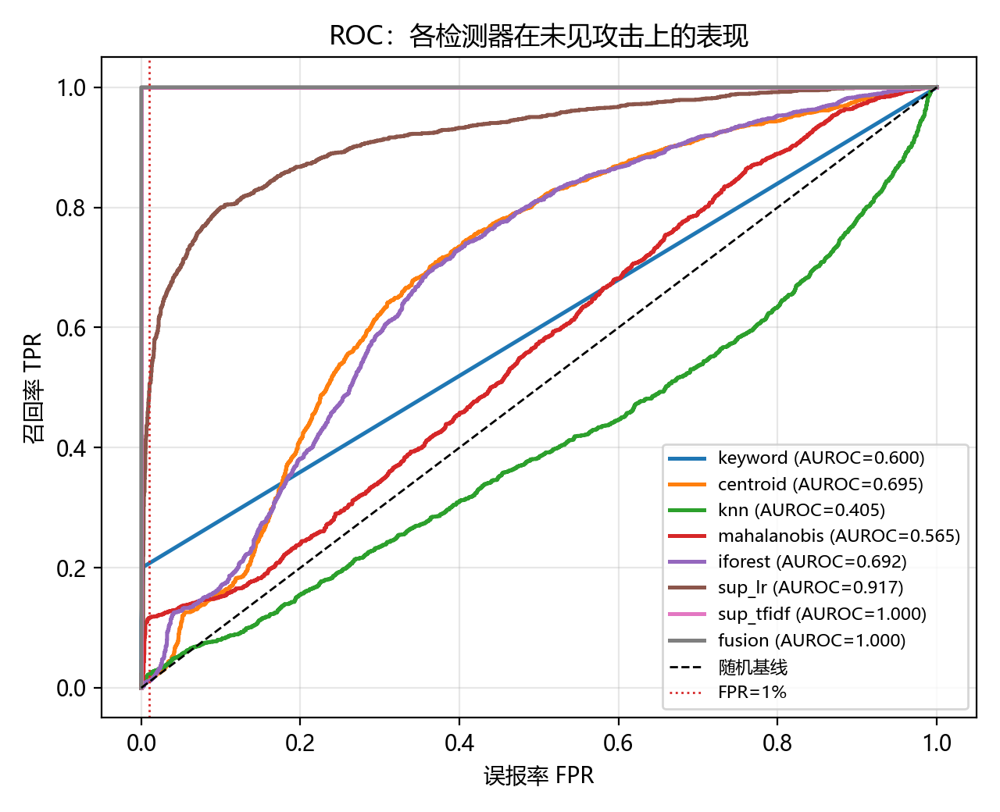

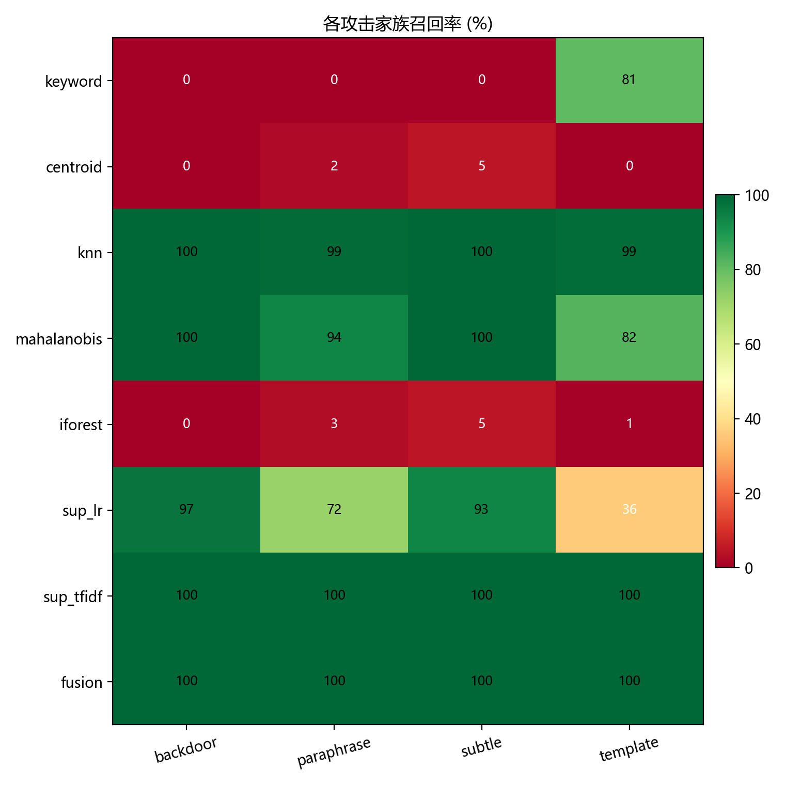

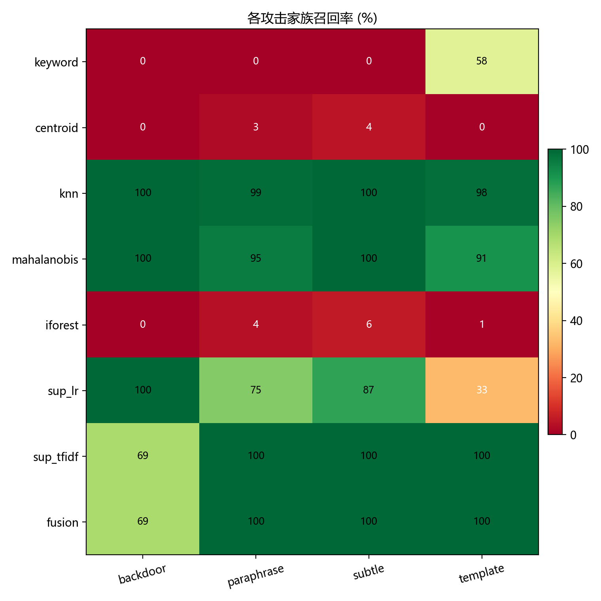

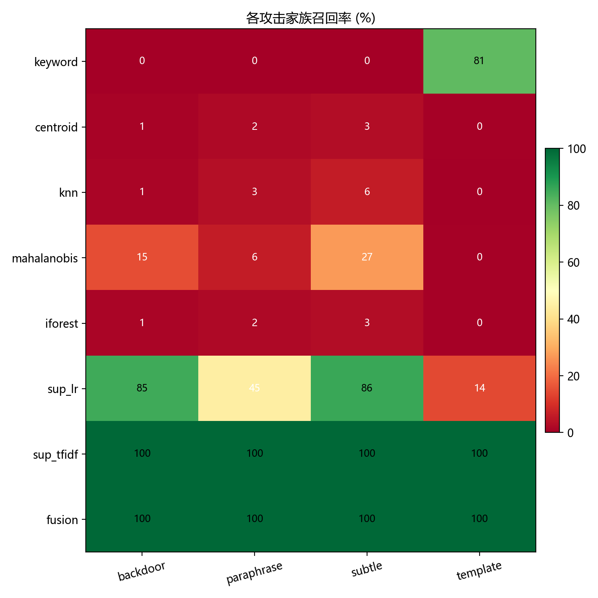

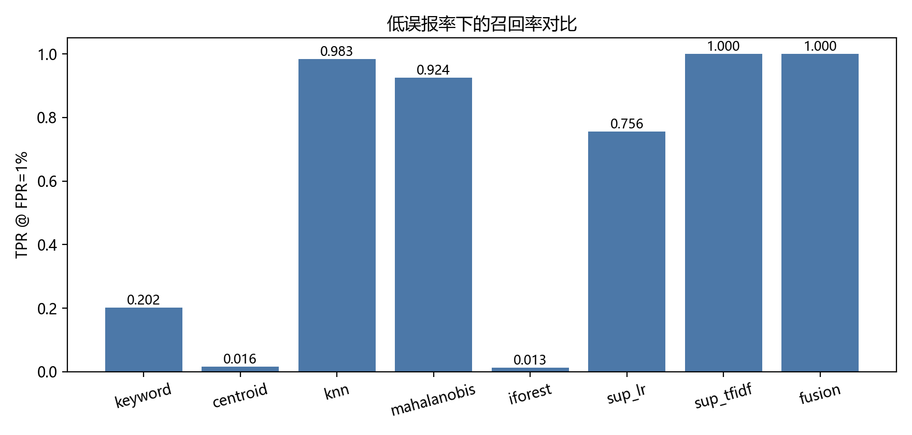

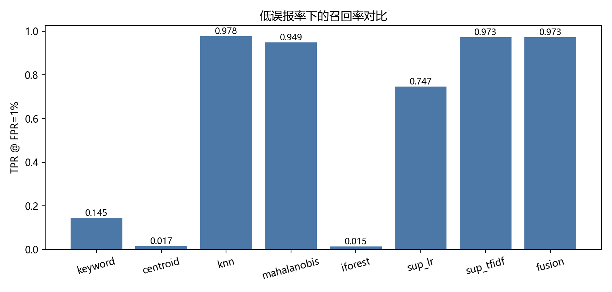

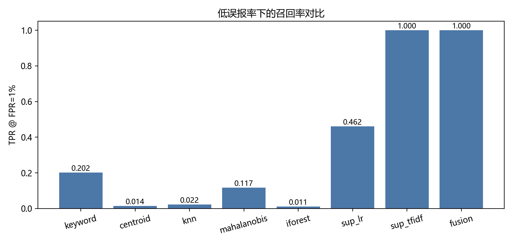

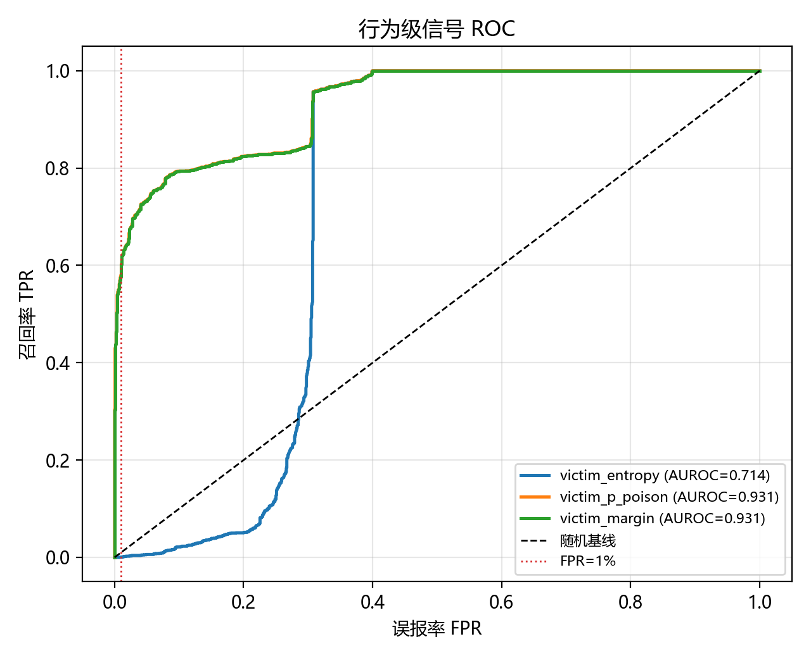

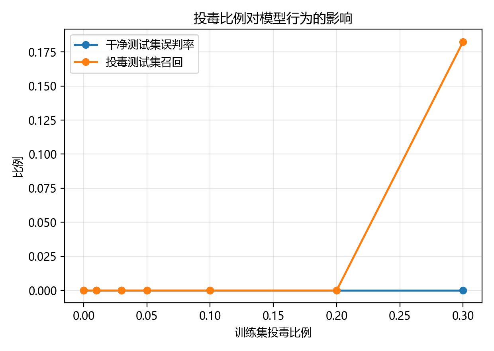

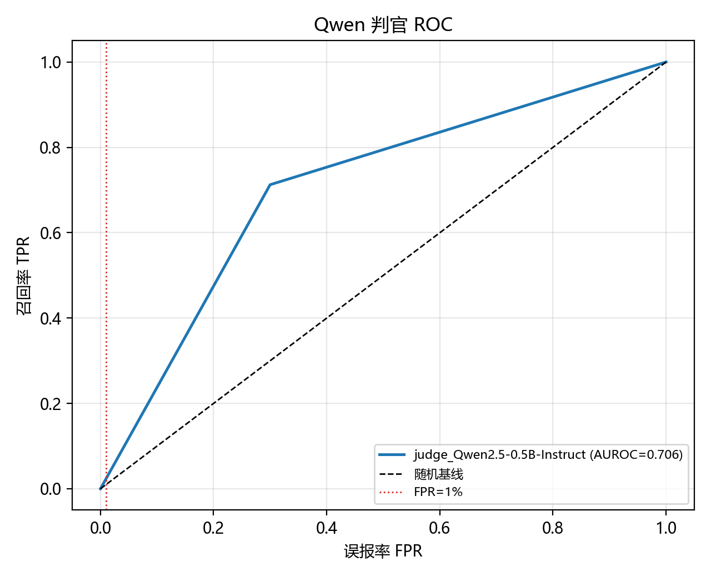

## 8. 已知局限(主动声明，不藏)

1. **攻击样本是程序生成的**，不是真实互联网投毒数据。`dev_seed ≠ test_seed` 只保证测试集不是训练时见过的字符串，但四类攻击都有固定措辞骨架，于是词面分类器(以及字符 n-gram 基线)学到的是"攻击生成器的口音"。第 3 节的硬负样本实验把这一点量化了：`knn` 在"攻击 vs 像传闻的无害新闻"上只有 0.500，而 `sup_tfidf` 仍为 1.000——后者的高分不应解读为"能识别有害性"。
2. **真实语料基准只换了干净侧**：攻击仍是合成文本，因此第 3 节证明的是"干净侧贫瘠贡献了多少虚高"，而不是"真实投毒场景下的绝对检出率"。下一步应改用「真实新闻 + 最小编辑式篡改」生成攻击，让两侧同为自然文本。
3. **受害模型权重来自旧项目，其训练数据存在 train=test 泄漏**，因此本报告只用它做相对信号(同模型内不同样本的置信度排序)，不引用它的绝对准确率。
4. **投毒比例消融用线性探针代替 BERT 重训**：规律可迁移，但绝对数值会与真实 BERT 重训不同，属于成本-精度的有意权衡。
5. **LLM 判官受限于本机算力**：未在真实 Qwen 权重上做全量评测时，该行为降级方案(启发式)单独标注，不进入主结论表。

## 9. 复现

```bash
python -m poisonguard.cli all                      # 数据→编码→检测→消融→报告
python -m poisonguard.cli detect                   # 只重跑检测
python -m poisonguard.cli audit                    # 词面审计(合成干净侧)
python -m poisonguard.cli download --corpus tnews  # 拉真实新闻语料(可复现第 3 节)
python -m poisonguard.cli detect --clean-source tnews     # 真实干净侧基准
python -m poisonguard.cli audit  --clean-source tnews     # 真实干净侧词面审计
python -m poisonguard.cli hardneg --clean-source tnews    # 硬负样本压力测试
python -m poisonguard.cli victim                   # 行为级信号(需 baseline_model.pth)
python -m poisonguard.cli judge --limit 40         # Qwen 判官(需权重)
python -m poisonguard.cli report                   # 重新渲染本报告
```
