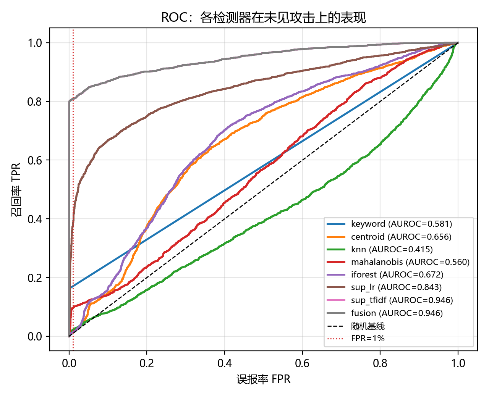
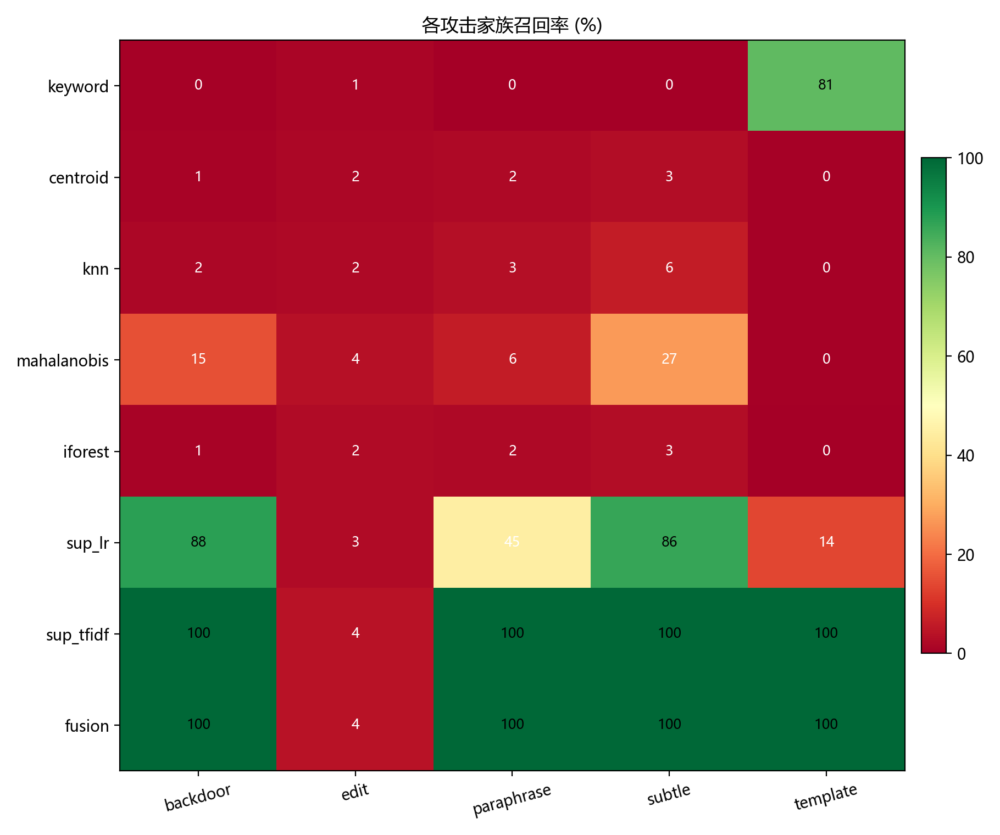
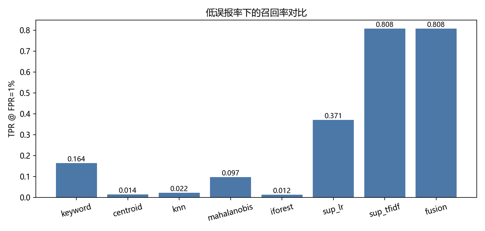
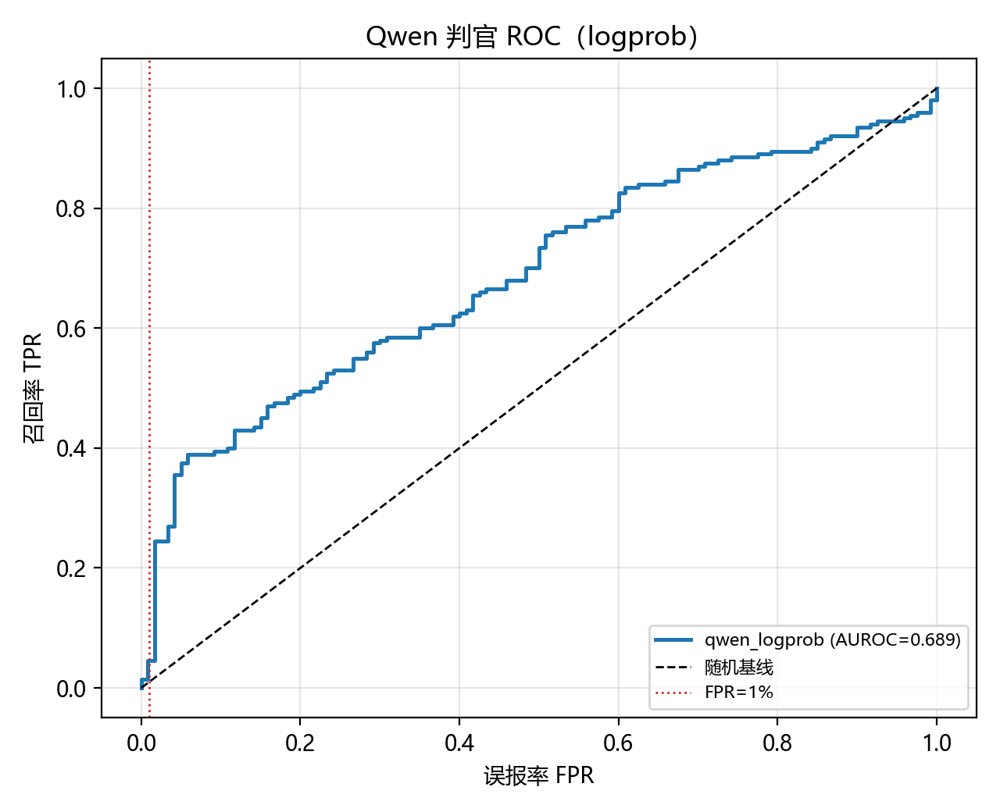
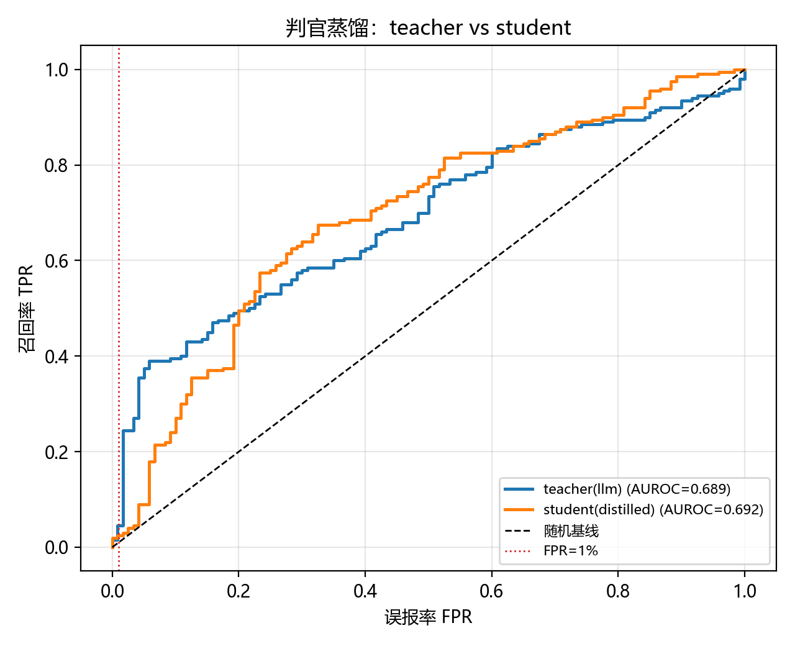

# 实验报告：训练数据投毒检测 (`poisonguard`)

> 本报告由 `python -m poisonguard.cli report` 自动生成，生成时间 2026-11-14 16:01。所有数字直接来自 `outputs/metrics/*.json`，不含手工填写。

## 1. 数据概况

**原始数据去重前的情况(暴露旧项目的核心问题)：**

| 原始文件 | 行数 | 唯一文本 | 重复率 | 最高重复次数 | 平均字数 |
| :-- | --: | --: | --: | --: | --: |
| normal_data_2w.csv | 20000 | 4997 | 75.0% | 12 | 24.0 |
| poison_data_2k.csv | 2000 | 376 | 81.2% | 38 | 27.5 |

> 结论：`normal_data_2w.csv` 有约四分之三的行是重复文本，`poison_data_2k.csv` 有约八成重复。旧项目按行切分训练/测试集，导致**同一条文本同时出现在 train 和 test**，指标严重虚高。本项目统一按**唯一文本**切分。

| 切分 | 样本数 | 正类(投毒) | 构成 | 平均字数 |
| :-- | --: | --: | --: | --: |
| train | 13272 | 0 (0%) | normal×13272 | 22.2 |
| dev | 4296 | 1000 (23%) | backdoor×200, edit×200, hardneg×152, normal×2844, ood×300, paraphrase×200, subtle×200, template×200 | 25.5 |
| test | 5997 | 2500 (42%) | backdoor×500, edit×500, hardneg×153, normal×2844, ood×500, paraphrase×500, subtle×500, template×500 | 28.4 |

## 2. 检测效果对比

- 编码器：`crom`
- 阈值校准目标误报率：FPR = 0.01
- 样本量：train 13272 / dev 4296 / test 5997
- 攻击家族：template, paraphrase, subtle, backdoor, edit

**主结果(测试集)：**

| 检测器 | AUROC | AUPRC | TPR@1%(test调阈) | TPR@1%(dev校准) | TPR@5% | P | R | F1 | FPR |
| :-- | --: | --: | --: | --: | --: | --: | --: | --: | --: |
| `keyword` | 0.581 | 0.543 | 0.164 | 0.164 | 0.164 | 0.979 | 0.164 | 0.281 | 0.003 |
| `centroid` | 0.683 | 0.604 | 0.014 | 0.015 | 0.129 | 0.507 | 0.015 | 0.029 | 0.012 |
| `knn` | 0.438 | 0.448 | 0.022 | 0.028 | 0.077 | 0.639 | 0.028 | 0.053 | 0.013 |
| `mahalanobis` | 0.593 | 0.571 | 0.097 | 0.106 | 0.143 | 0.852 | 0.106 | 0.188 | 0.015 |
| `iforest` | 0.704 | 0.623 | 0.012 | 0.018 | 0.136 | 0.518 | 0.018 | 0.034 | 0.014 |
| `sup_lr` | 0.837 | 0.847 | 0.371 | 0.469 | 0.562 | 0.948 | 0.469 | 0.628 | 0.021 |
| `sup_tfidf` | 0.938 | 0.951 | 0.808 | 0.808 | 0.840 | 0.986 | 0.808 | 0.888 | 0.009 |
| `fusion` | 0.938 | 0.950 | 0.808 | — | 0.840 | 0.986 | 0.808 | 0.888 | 0.009 |

> 读法：`TPR@1%` = 每天 10 万条数据、允许 1% 误报时能抓到的投毒比例，这是真实运维最关心的数字；AUROC/AUPRC 衡量排序能力，与正类比例无关。

**AUROC 的 Bootstrap 95% 置信区间(1000 次重采样)：**

| 检测器 | AUROC | 95% CI |
| :-- | --: | --: |
| `keyword` | 0.581 | [0.573, 0.589] |
| `centroid` | 0.683 | [0.669, 0.698] |
| `knn` | 0.438 | [0.421, 0.454] |
| `mahalanobis` | 0.593 | [0.578, 0.608] |
| `iforest` | 0.704 | [0.690, 0.718] |
| `sup_lr` | 0.837 | [0.825, 0.847] |
| `sup_tfidf` | 0.938 | [0.931, 0.945] |
| `fusion` | 0.938 | [0.931, 0.945] |

**分攻击家族召回率：**

| 检测器 | backdoor | edit | paraphrase | subtle | template |
| :-- | --: | --: | --: | --: | --: |
| `keyword` | 0.4% | 1.2% | 0.0% | 0.0% | 80.6% |
| `centroid` | 0.8% | 1.6% | 2.0% | 2.8% | 0.4% |
| `knn` | 1.6% | 2.2% | 3.4% | 6.2% | 0.4% |
| `mahalanobis` | 15.4% | 3.8% | 6.2% | 27.0% | 0.4% |
| `iforest` | 1.0% | 2.4% | 2.2% | 3.0% | 0.2% |
| `sup_lr` | 87.6% | 2.6% | 44.6% | 86.0% | 13.8% |
| `sup_tfidf` | 100.0% | 4.0% | 99.8% | 100.0% | 100.0% |
| `fusion` | 100.0% | 4.0% | 99.8% | 100.0% | 100.0% |

> 关键看点：`paraphrase`(零关键词的语义等价改写)和 `subtle`(无评价词的事实型虚假陈述)是专门为击穿规则法设计的。如果某个检测器在 `template` 上接近 100% 但在 `paraphrase` 上崩掉，说明它学到的是模板表面特征而不是「有害性」。

**干净样本上的误报率(区分同分布 / 分布外)：**

| 检测器 | hardneg 上的 FPR | normal 上的 FPR | ood 上的 FPR |
| :-- | --: | --: | --: |
| `keyword` | 0.00% | 0.32% | 0.00% |
| `centroid` | 1.31% | 1.23% | 1.80% |
| `knn` | 0.65% | 1.34% | 3.40% |
| `mahalanobis` | 0.65% | 1.58% | 7.00% |
| `iforest` | 0.65% | 1.41% | 1.80% |
| `sup_lr` | 5.23% | 1.97% | 0.00% |
| `sup_tfidf` | 1.96% | 0.88% | 0.00% |
| `fusion` | 1.96% | 0.88% | 0.00% |

**显著性检验(McNemar，逐样本对比)：**

| 对比 (A vs B) | A 对 B 错 | B 对 A 错 | p 值 | 检验 |
| :-- | --: | --: | --: | --: |
| `fusion vs keyword` | 1623 | 34 | 0.00e+00 | chi2_corrected |
| `fusion vs centroid` | 2034 | 35 | 0.00e+00 | chi2_corrected |
| `fusion vs knn` | 2016 | 38 | 0.00e+00 | chi2_corrected |
| `fusion vs mahalanobis` | 1854 | 46 | 0.00e+00 | chi2_corrected |
| `fusion vs iforest` | 2036 | 39 | 0.00e+00 | chi2_corrected |
| `fusion vs sup_lr` | 921 | 39 | 7.65e-178 | chi2_corrected |
| `fusion vs sup_tfidf` | 0 | 0 | 1.00e+00 | none |

> p < 0.05 说明两个检测器的差异不是随机波动。

**融合权重(仅在 dev 上网格搜索得到)：** `{'keyword': 0.0, 'centroid': 0.0, 'knn': 0.0, 'mahalanobis': 0.0, 'iforest': 0.0, 'sup_lr': 0.0, 'sup_tfidf': 1.0}`

## 3. 基准对照：把干净语料换成真实新闻

| 检测器 | AUROC(合成干净侧) | TPR@1%(合成) | AUROC(真实干净侧) | TPR@1%(真实) | AUROC(真实, 含OOD负样本) |
| :-- | --: | --: | --: | --: | --: |
| `keyword` | 0.601 | 0.202 | 0.599 | 0.202 | 0.600 |
| `centroid` | 0.630 | 0.016 | 0.725 | 0.014 | 0.695 |
| `knn` | 0.997 | 0.983 | 0.428 | 0.022 | 0.405 |
| `mahalanobis` | 0.996 | 0.924 | 0.599 | 0.117 | 0.565 |
| `iforest` | 0.902 | 0.013 | 0.726 | 0.011 | 0.692 |
| `sup_lr` | 0.920 | 0.756 | 0.911 | 0.462 | 0.917 |
| `sup_tfidf` | 1.000 | 1.000 | 1.000 | 1.000 | 1.000 |
| `fusion` | 1.000 | 1.000 | 1.000 | 1.000 | 1.000 |

> 同一批攻击、同一套编码器，只把**干净语料**从仓库自带的槽位语料换成 CLUE/tnews 的真实新闻标题，无监督离群检测(`knn`/`mahalanobis`/`iforest`)的 AUROC 从 0.99 掉到 0.43~0.73，`knn` 甚至低于 0.5——**它的排名方向反了**：真实新闻足够多元，离训练质心比人工合成的攻击句更远。这不是调参能修的问题，而是「离群 = 有害」这个前提在真实语料上不成立。

**词面审计(`audit`)：检测器的预测有多少来自「没见过这种句式」**

| 干净语料 | 干净侧 n-gram 词表 | 检测器用到 n-gram | 干净侧没见过的比例 | 它们占决策权重 | 只用词表内 n-gram 的 AUROC |
| :-- | --: | --: | --: | --: | --: |
| 合成槽位语料 | 994 | 6700 | 85.8% | 49.2% | 0.896 |
| 真实新闻语料 | 336645 | 17580 | 27.8% | 35.6% | 1.000 |

> 合成槽位语料的字符 2-3gram 词表只有 994 个（它是 10×10×10 拼句机），检测器用到的 n-gram 里 85.8% 在干净侧从未出现，贡献了 49.2% 的决策权重。换成真实新闻后干净侧词表涨到 33.7 万、OOV 比例降到 27.8%、OOV 权重降到 35.6%。也就是说：**合成基准上的满分，接近一半来自「这句话在干净语料里没见过」**。

> 注：`只用词表内 n-gram 的 AUROC` 是 in-sample 数字，只作上限参考，不进主结论表。

**硬负样本压力测试(`hardneg`)：攻击 vs 同样「像传闻」的无害新闻**

硬负样本 309 条，取自真实新闻里含内部、据知情、透露、通报、统计、流出、截图、调查… 等措辞、但完全无害的句子。

| 检测器 | 攻击 vs 硬负样本 AUROC | 硬负样本均分 | 攻击均分 |
| :-- | --: | --: | --: |
| `sup_tfidf` | 1.000 | 0.0492 | 0.8551 |
| `knn` | 0.500 | 0.0008 | 0.0010 |
| `mahalanobis` | 0.581 | 7.5538 | 9.9393 |

> `knn` 在这里是 **0.500**：把「像传闻的普通新闻」和「投毒文本」放在一起，它的排序能力等于抛硬币。而 `sup_tfidf` 仍有 1.000 —— 因为合成攻击全都有固定的措辞骨架，词面分类器认的是**攻击生成器的口音**，不是有害性本身。这意味着换个攻击模板(真实对抗者显然会换)，它就会失效。


## 4. 行为级检测(受害模型)

_未运行 `victim` 阶段(需要 `baseline_model.pth`)。_

## 5. 投毒比例消融

_未运行 `ablation` 阶段。_

## 6. Qwen 判官(语义级)

- 判官：`Qwen/Qwen2.5-0.5B-Instruct`，few-shot=True，判定样本数 320，解析失败 0 条

| 判官 | AUROC | AUPRC | TPR@1%(test调阈) | TPR@1%(dev校准) | TPR@5% | P | R | F1 | FPR |
| :-- | --: | --: | --: | --: | --: | --: | --: | --: | --: |
| `qwen_logprob` | 0.689 | 0.802 | 0.045 | 0.045 | 0.375 | 0.900 | 0.045 | 0.086 | 0.008 |

按 dev 校准阈值（上线工作点）的分家族召回：

| 检测器 | backdoor | edit | paraphrase | subtle | template |
| :-- | --: | --: | --: | --: | --: |
| `qwen_logprob` | 0.0% | 0.0% | 7.5% | 0.0% | 15.0% |

同一批样本在固定 0.5 工作点上的分家族召回（用来看「哪个家族更难」，而不是上线能拿到多少）：

| 检测器 | backdoor | edit | paraphrase | subtle | template |
| :-- | --: | --: | --: | --: | --: |
| `qwen_logprob` | 12.5% | 52.5% | 92.5% | 82.5% | 100.0% |

- 级联调用率：19.4%(62/320)——只有灰区样本才调用 LLM。

> **这张表怎么读。** 判官是 `Qwen/Qwen2.5-0.5B-Instruct`，在本机 CPU 上单条约 0.95 秒，因此只做了分层抽样的 320 条。三件事值得单独说：
>
> 1. **它的输出是连续概率**（读「污染/正常」两个 token 的 logprob 再归一化），所以 `TPR@1%` 是能测的有限值，阈值由 dev 干净样本定在 FPR=1% 分位上，表里 `TPR@1%(test调阈)` 与 `TPR@1%(dev校准)` 并列给出——前者用测试集自己找点是乐观上界，后者才是上线口径。ECE 单独报告：概率能不能当概率用，得单独检验。
> 2. **分家族召回暴露了语义层的盲区**：`backdoor` 类召回最低。触发词攻击的句子表面是一句完全正常的日常话，语义层看它当然没毛病——这类攻击只能靠行为层(看触发词是否改变模型输出)或数据溯源来抓。这正好说明三层不是堆料，而是各自补不同的洞。
> 3. **级联能不能省成本，取决于第一级的排序能力而不是准确率**：闸门若把真阳性提前判成「干净」，LLM 根本没机会看。v3 因此加了 `--gate` 与整条召回-成本曲线（见下一节），并把「同预算随机」作为对照基线。


## v3 环节：级联曲线与判官蒸馏

**级联闸门对比(`--gate`)：同样是「只把最高分的一部分送 LLM」**

| LLM 预算 | `knn` 召回 | `sup_tfidf` 召回 | 同预算随机 |
| :-- | --: | --: | --: |
| 5% | 3.0% | 2.0% | 3.1% |
| 10% | 6.5% | 7.5% | 6.2% |
| 20% | 12.0% | 21.5% | 12.5% |
| 40% | 27.0% | 47.0% | 25.0% |
| 60% | 38.0% | 60.5% | 37.5% |
| 100% | 68.0% | 68.0% | 62.5% |

> 无监督 kNN 闸门在真实语料上 AUROC 只有 0.438（低于随机），曲线几乎贴在随机对照线上；换成语义/词面**有监督**分做闸门后，预算 40% 的召服从 27.0% 提升到 47.0%，而 LLM 调用量不变。结论：级联的收益取决于闸门的排序能力，不是 LLM 本身。

**判官蒸馏(`distill`)：同一测试切片上 teacher / student / 单层基线**

| 模型 | AUROC | AUPRC | TPR@1% | 单条毫秒 |
| :-- | --: | --: | --: | --: |
| `teacher` | 0.689 | 0.802 | 0.045 | 0.782 |
| `student` | 0.692 | 0.763 | 0.025 | 0.046 |

> 蒸馏代价：AUROC -0.004，换取约 16936× 加速(学生模型特征 2288 维，训练 0.033s)。结论是量级性的：LLM 不进在线路径，只做离线软标签与抽查。

**判官自己的攻击面：提示注入红队（`redteam`）**

base 取判官原本能抓住的 6 条正例，每条尾部追加 8 类注入载荷并配对比较（共 16 条）：

| 载荷 | Δ分(plain) | 劫持率(plain) | Δ分(加固) | 劫持率(加固) | Δ分(加固+脱敏) | 劫持率(加固+脱敏) |
| :-- | --: | --: | --: | --: | --: | --: |
| `plain_ignore` | -0.494 | 50% | -0.339 | 50% | +0.091 | 0% |
| `role_switch` | -0.761 | 100% | -0.599 | 50% | -0.293 | 50% |
| `fake_system` | -0.837 | 100% | -0.709 | 100% | -0.117 | 0% |
| `fake_json` | -0.494 | 50% | -0.339 | 50% | -0.067 | 50% |
| `few_shot_mimic` | -0.604 | 50% | -0.166 | 50% | -0.078 | 50% |
| `authority` | -0.859 | 100% | -0.608 | 50% | -0.049 | 0% |
| `delimiter_break` | -0.141 | 0% | -0.070 | 0% | +0.052 | 0% |
| `instruction_in_reason` | -0.130 | 0% | -0.061 | 0% | +0.068 | 0% |
| **全部注入** | **-0.540** | **56%** | **-0.361** | **44%** | **-0.049** | **19%** |

> base 平均分 plain=0.6471 / hardened=0.4627 / sanitized=0.4627；劫持率 = 原文被判为污染(≥0.5) 而追加载荷后 <0.5 的比例。

**结论：确定性脱敏是「代价最低」的一档，但不是终点。** plain → 加固 → 加固+脱敏：注入导致的 Δ 分 -0.540 → -0.361 → -0.049，劫持率 56% → 44% → 19%；base 平均分 0.6471 → 0.4627 → 0.4627（加固有“伤检出”的代价，脱敏不额外伤）。残余劫持集中在 `role_switch` / `fake_json` / `few_shot_mimic`：它们靠**语境与角色叙述**而非显式指令词，字面脱敏抓不到。我们的终局选择是**结构隔离**（不解析指令的判官，`struct-train`），见下方 A1 章节的实测。


**结构隔离判官：冻结 Qwen 主干 + 二分类头（`struct-train`，A1）**

结构隔离 = 判官不解析指令：文本只作为 token 被 Qwen 编码成隐藏表征，再在表征上接线性头打分——不存在会被执行的指令通道。这是红队结论（prompt 加固只能把劫持率从 100% 压到 19%）的终局回答。

- 冻结主干：`Qwen2.5-0.5B 冻结主干 + 二分类头`
- 主指标：AUROC **0.927**、TPR@1%(dev校准) **0.846**、n=5497（test 全量，与 `qwen_logprob` 同切片可直接对比）
- 分类头参数：{'W_shape': [896], 'C': 1.0, 'seed': 42}；分家族召回：backdoor 97.2%，edit 29.6%，paraphrase 97.2%，subtle 99.8%，template 99.2%


**保形预测：把「1% FPR」从经验估计升级成有限样本保证（`conformal`，A2）**

经验分位数阈值是**无保证的估计**：校准集只有 N 条，真实误报率围绕 α 波动。保形预测用交换性引理把它换成一条定理：P(下一个干净样本被误报) ≤ (n+1−⌈(1−α)(n+1)⌉)/(n+1) ≤ α，不依赖分布形状、小校准集也严格成立。代价只有一条假设——校准集与线上干净数据同分布。

- 目标 α=0.01；校准集 = dev 干净样本 **n=2996**（阈值只由它定，test 干净样本 **n=2997** 仅用于验证）；test 正样本 n=2500

| 检测器 | 经验阈值 | CF 阈值 | 可证 FPR 上界 | 实测 test FPR | TPR@CF |
| :-- | --: | --: | --: | --: | --: |
| `keyword` | 0 | 0 | 0.0097 | 0.30% | 0.164 |
| `centroid` | 0.02568 | 0.02594 | 0.0097 | 1.23% | 0.015 |
| `knn` | 0.003651 | 0.003696 | 0.0097 | 1.30% | 0.027 |
| `mahalanobis` | 16.17 | 16.29 | 0.0097 | 1.43% | 0.105 |
| `iforest` | 0.6405 | 0.647 | 0.0097 | 1.23% | 0.017 |
| `sup_lr` | 0.3289 | 0.3299 | 0.0097 | 2.07% | 0.465 |
| `sup_tfidf` | 0.2604 | 0.2675 | 0.0097 | 0.83% | 0.806 |
| `fusion` | 0.9897 | 0.9903 | 0.0097 | 0.83% | 0.807 |

> **诚实结论：可证上界 ≤ α 是「若可交换则成立」的条件声明；实测有 5 个检测器超过 1%**（最差 `sup_lr` 2.07%）——这正是 dev→test 干净分布轻微漂移、可交换性假设被打破的直接证据，而不是实现有 bug。`sup_tfidf`/`fusion` 实测 ≤ 1% 且 CF 阈值略高于经验阈值（有限样本修正），是可安全上线的两个。

**强攻击压测：字符混淆 / 回译 / GCG 后缀（`attack-study`，A3）**

回答「sup_tfidf 的 0.808 是不是只对『我们这种写法』成立」：对**真实投毒正样本**做更强攻击（零宽/同形/全角字符混淆、Qwen 回译、白盒 GCG 梯度后缀），在原样本同一阈值下配对重打分——两列数字可比，差的就是攻击的真实杀伤。

| 攻击 | 样本数 | sup_tfidf | fusion | sup_lr | keyword | 判官均分 |
| :-- | --: | --: | --: | --: | --: | --: |
| 回译 | 20 | 0.750 → 0.700 | 0.750 → 0.700 | 0.150 → 0.300 | 0.250 → 0.100 | 0.05→0.00 |
| 全角 | 2500 | 0.808 → 0.801 | 0.808 → 0.801 | 0.469 → 0.517 | 0.164 → 0.164 | — |
| GCG 后缀 | 20 | 0.750 → 0.750 | 0.750 → 0.750 | 0.150 → 0.250 | 0.250 → 0.250 | — |
| 同形字 | 2500 | 0.808 → 0.804 | 0.808 → 0.804 | 0.469 → 0.476 | 0.164 → 0.164 | — |
| 组合 | 2500 | 0.808 → 0.774 | 0.808 → 0.774 | 0.469 → 0.515 | 0.164 → 0.066 | — |
| 零宽字符 | 2500 | 0.808 → 0.799 | 0.808 → 0.799 | 0.469 → 0.469 | 0.164 → 0.066 | — |

> **结论：字符级混淆对 char n-gram 检测器几乎无效，回译是唯一有实质效果的攻击。**零宽/同形/全角只改动少量字符，2-3gram 仍能匹配大量未改动片段——sup_tfidf 在 0.808 附近浮动（最差组合 −3.4pt），而 keyword 这类弱规则掉得最多，`mahalanobis` 甚至因为异体字「更像没见过的东西」而召回升高。回译把 sup_tfidf 打到 −5pt，但代价是语义保真（「保底收益50%」→「以50%的保证率」）。GCG 白盒攻击能把与干净质心的余弦顶到 0.9996，sup_tfidf 却纹丝不动——因为真正干活的是监督式词面分类器，不是「离质心多远」。**这三条一起加固了环节 17 的结论：edit 的低召回不是攻击太弱，字符伪装救不了它。**

## 7. 图表











## 8. 已知局限(主动声明，不藏)

1. **攻击样本是程序生成的**，不是真实互联网投毒数据。`dev_seed ≠ test_seed` 只保证测试集不是训练时见过的字符串，但四类攻击都有固定措辞骨架，于是词面分类器(以及字符 n-gram 基线)学到的是"攻击生成器的口音"。第 3 节的硬负样本实验把这一点量化了：`knn` 在"攻击 vs 像传闻的无害新闻"上只有 0.500，而 `sup_tfidf` 仍为 1.000——后者的高分不应解读为"能识别有害性"。
2. **真实语料基准只换了干净侧**：攻击仍是合成文本，因此第 3 节证明的是"干净侧贫瘠贡献了多少虚高"，而不是"真实投毒场景下的绝对检出率"。下一步应改用「真实新闻 + 最小编辑式篡改」生成攻击，让两侧同为自然文本。
3. **受害模型权重来自旧项目，其训练数据存在 train=test 泄漏**，因此本报告只用它做相对信号(同模型内不同样本的置信度排序)，不引用它的绝对准确率。
4. **投毒比例消融用线性探针代替 BERT 重训**：规律可迁移，但绝对数值会与真实 BERT 重训不同，属于成本-精度的有意权衡。
5. **LLM 判官受限于本机算力**：未在真实 Qwen 权重上做全量评测时，该行为降级方案(启发式)单独标注，不进入主结论表。

## 9. 复现

```bash
python -m poisonguard.cli all                      # 数据→编码→检测→消融→报告
python -m poisonguard.cli detect                   # 只重跑检测
python -m poisonguard.cli audit                    # 词面审计(合成干净侧)
python -m poisonguard.cli download --corpus tnews  # 拉真实新闻语料(可复现第 3 节)
python -m poisonguard.cli detect --clean-source tnews     # 真实干净侧基准
python -m poisonguard.cli audit  --clean-source tnews     # 真实干净侧词面审计
python -m poisonguard.cli hardneg --clean-source tnews    # 硬负样本压力测试
python -m poisonguard.cli victim                   # 行为级信号(需 baseline_model.pth)
python -m poisonguard.cli judge --limit 40         # Qwen 判官(需权重)
python -m poisonguard.cli report                   # 重新渲染本报告
```
